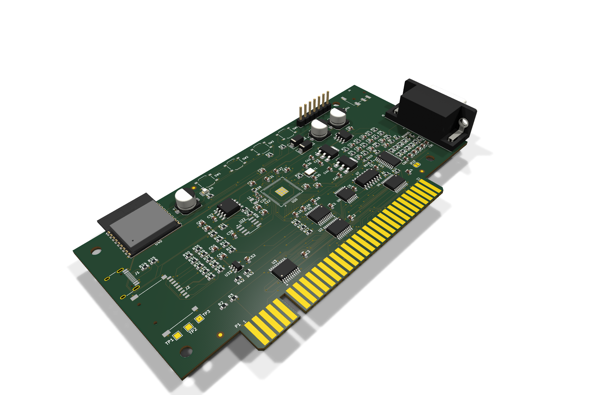
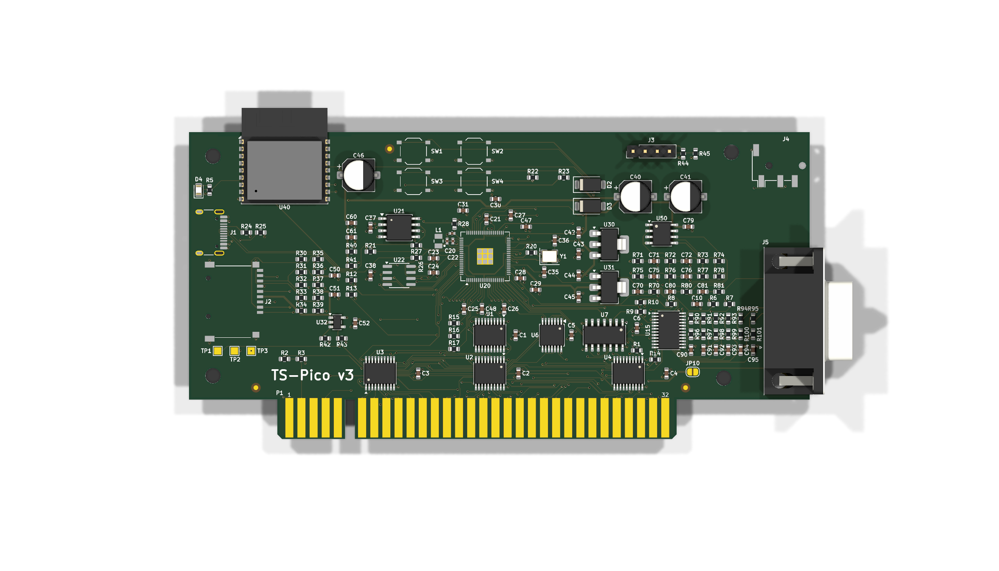
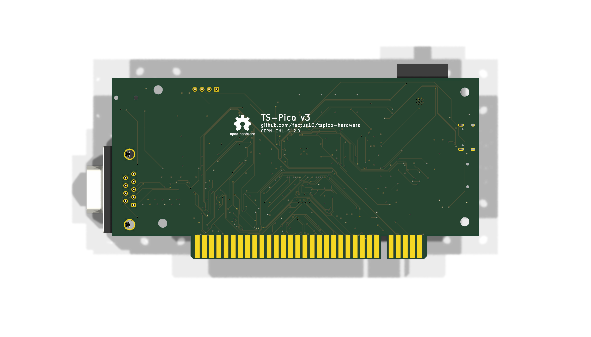
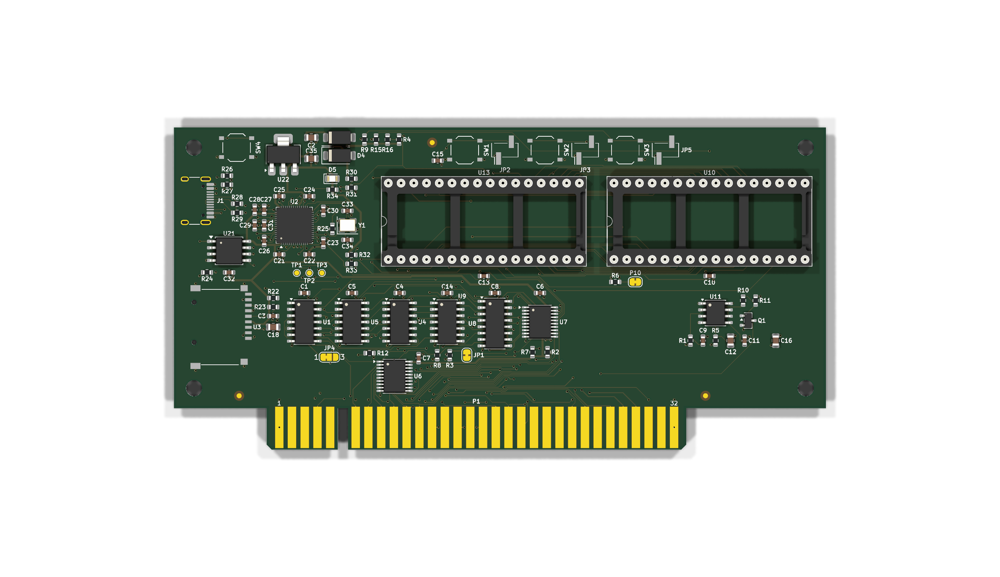
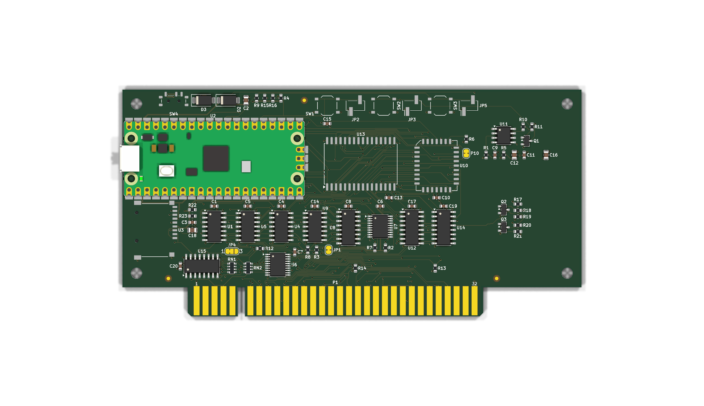

# TS-Pico hardware

Hardware for the TS-Pico, a mass-storage, ROM, and now WiFi/sound expansion card for the Timex Sinclair 2068.

## What the TS-Pico does

The TS-Pico plugs into the TS2068's rear expansion connector, with a Raspberry Pi microcontroller on the card. To the 2068 it looks like memory and I/O ports:

- **ROMs and cartridges.** The card can replace the 2068's HOME ROM and EXROM and act as a DOCK cartridge, serving the images from its own memory. It comes with its own patched 2068 ROM, which knows how to talk to the card.
- **Mass storage.** LOAD and SAVE go to files on a micro SD card instead of tape, and the card also takes `tpi:` commands. The 2068 talks to the card through I/O ports $0E/$0F.
- **Printer.** LPRINT, LLIST and COPY go to the card.

v3 adds WiFi, sound, a joystick port and a display on top of that.

## The boards

| | v2.2 | v2.5 | v2.6 | v3 |
|---|---|---|---|---|
| Status | Shipped 2023 | Prototype, not built | Prototype, not built | Proto1 built and brought up; proto3 is current |
| Controller | Raspberry Pi Pico on socket headers | Pico module soldered on its castellations (a Pico 2 fits) | RP2040 on the board, 2 MB QSPI flash, USB-C | RP2350B on the board, 16 MB QSPI flash, USB-C, PSRAM footprint (8 MB, hand-fitted) |
| Card memory | 512 KB flash (SST39SF040) + 512 KB SRAM, DIP | Same chips, SMT (PLCC flash, SOIC SRAM) | Same DIP chips, socketed | None: the RP2350B serves ROM and DOCK images from its own SRAM with PIO and DMA |
| Construction | Through-hole | All SMT, JLCPCB-assembled | SMT except the two DIP sockets | All SMT except the DE-9 and OLED header |
| Firmware | Shipped TS-Pico firmware | Runs it unchanged | Runs it unchanged | Ported (v2.3.1 runs on v3) |

**v2.2** (`old/`) is the card that shipped in September 2023. It has a Pico on headers, flash and SRAM chips, 74LS glue logic and a 555 power-on reset. The 2068 reads its ROM and cartridge images from the flash or SRAM in 16 slots of 32 KB, and the Pico switches the banks. The micro SD sits on a breakout module and shares three data lines with the bus. A jumper picks the port pair ($00-$0F or $10-$1F). The design is kept here for reference only.

**v2.5** (`hardware-v2.5/`) is the v2.2 circuit redrawn all surface mount, so JLCPCB can assemble it. It uses the v3 board outline and has a push-push micro SD socket. One block is new: **bench programming**, which lets the Pico write a blank soldered flash from USB, with no ROM programmer or 2068 needed.

**v2.6** (`hardware-v2.6/`) is the v2.2 circuit with the RP2040 chip on the board instead of a Pico module. The flash and SRAM go back to DIP-32 chips in sockets, programmed in a ROM programmer as v2.2's were. Proto2 rebuilds the glue logic in 74LVC and replaces the 555 with a TPS3808 reset supervisor.

**v3** (`hardware/`) is a redesign around the RP2350B. It keeps the firmware's view of the bus and adds:

- **Memory without memory chips.** PIO and DMA answer every Z80 memory cycle from the RP2350B's SRAM. Images live as files on the QSPI flash or the SD card, and a slot map file replaces the fixed flash banks.
- **Micro SD** on its own SPI bus, with a current-limited power switch, so a card that latches up can be power-cycled.
- **WiFi:** an ESP32-C3 running Zimodem. The card emulates the TS2050 modem's Intel 8251 at ports $73/$77.
- **Kempston joystick:** a DE-9 (Atari pinout) at port $1F.
- **Stereo audio:** PWM from the RP2350B, mixed with the 2068's SOUND line by an op-amp, out a 3.5 mm jack. It is intended for AY-3-8910 emulation, which the firmware has not scheduled yet.
- **Display:** a 128x64 SSD1309 OLED on I2C (proto3; proto1 and proto2 have a header for a 128x96 SPI module).
- **Tape:** EAR out and SPK/TAP in.
- **Bus control:** the card holds the 2068 in reset until it is ready, instead of a fixed 555 delay. There is also a /WAIT output, which the firmware does not use.
- **Power:** the card runs from the 2068's 5 V or from USB-C alone on the bench.
- **Buttons:** TS Reset, NMI, RUN and BOOTSEL.

The full spec is [docs/v3-architecture.md](docs/v3-architecture.md). Firmware progress is in [docs/v3-firmware-port-plan.md](docs/v3-firmware-port-plan.md).

## Repository

| Folder | What |
|---|---|
| `hardware/` | TS-Pico v3: KiCad 10 project. RP2350B chip-down, surface mount, JLCPCB assembly. See `hardware/README.md`; order files in [v3.0-proto3.1](https://github.com/factus10/tspico-hardware/releases/tag/v3.0-proto3.1). |
| `hardware-v2.5/` | TS-Pico v2.5: the v2.2 circuit all surface mount on the v3 outline, plus bench programming of the flash from the Pico. KiCad 10. See `hardware-v2.5/README.md`; order files in [v2.5-proto1](https://github.com/factus10/tspico-hardware/releases/tag/v2.5-proto1). |
| `hardware-v2.6/` | TS-Pico v2.6: the v2.2 circuit with the RP2040 on the board, SMT except the DIP-32 flash and SRAM (socketed, hand-soldered). KiCad 10. See `hardware-v2.6/README.md`; order files in [v2.6-proto2](https://github.com/factus10/tspico-hardware/releases/tag/v2.6-proto2). |
| `docs/` | [PLAN.md](PLAN.md) (plan), [docs/v3-architecture.md](docs/v3-architecture.md) (interface spec), part mapping, archived variants. |
| `old/` | TS-Pico v2.2: the shipped through-hole design (CircuitStudio project and full fab package, September 2023). Reference only. |



The v3 board (prototype 3). Schematic: [hardware/docs/tspico-v3-schematic.pdf](hardware/docs/tspico-v3-schematic.pdf). PCB layers: [hardware/docs/tspico-v3-pcb.pdf](hardware/docs/tspico-v3-pcb.pdf).

| v3 top | v3 bottom |
|---|---|
|  |  |

| v2.6 | v2.5 |
|---|---|
|  |  |

Firmware lives in [tspico-firmware-build](https://github.com/timex-sinclair-projects/tspico-firmware-build).

## Ordering a board

Ready-to-upload JLCPCB packages (Gerbers, BOM, placement, ordering notes, schematic PDF, renders) are attached to the GitHub releases. All are prototypes. v3 proto1 has been built and brought up (`firmware/bringup/README.md`); proto2 carries its fixes, and proto3 adds a male DE-9 for Atari sticks, a 4-pin header for an I2C SSD1309 OLED and the buttons in a 2x2 block. The others have not been built yet.

| Board | Release |
|---|---|
| v2.6: RP2040 on the board, DIP-32 flash and SRAM in sockets (hand-soldered), 74LVC glue | [v2.6-proto2](https://github.com/factus10/tspico-hardware/releases/tag/v2.6-proto2) (proto1, with 74LS glue: [v2.6-proto1](https://github.com/factus10/tspico-hardware/releases/tag/v2.6-proto1)) |
| v2.5: all surface mount, Pico module, bench programming of the flash | [v2.5-proto1](https://github.com/factus10/tspico-hardware/releases/tag/v2.5-proto1) |
| v3: RP2350B, WiFi, audio, joystick | [v3.0-proto3.1](https://github.com/factus10/tspico-hardware/releases/tag/v3.0-proto3.1): proto3 with board labels, L1 assembled (earlier: [v3.0-proto3](https://github.com/factus10/tspico-hardware/releases/tag/v3.0-proto3), no labels, L1 by hand; [v3.0-proto2.1](https://github.com/factus10/tspico-hardware/releases/tag/v3.0-proto2.1), proto2 with L1 fitted by hand; [v3.0-proto2](https://github.com/factus10/tspico-hardware/releases/tag/v3.0-proto2) assembles L1; proto1, built, before the bring-up fixes: [v3.0-proto1](https://github.com/factus10/tspico-hardware/releases/tag/v3.0-proto1)) |

## Working on the v3 hardware

Requirements: KiCad 10 (`kicad-cli` is used for checks), Python 3.

```bash
python3 hardware/scripts/gen_board.py   # regenerate the edge-connector footprint and board skeleton
hardware/scripts/check.sh               # ERC + DRC, fails on any violation
```

See `hardware/README.md` for the project layout and the geometry the edge connector is built from.

## License

The hardware designs in this repository (`hardware/`, `hardware-v2.5/`, `hardware-v2.6/`, `old/` and the design documents in `docs/`) are released under the [CERN Open Hardware Licence Version 2, Strongly Reciprocal](LICENSE) (CERN-OHL-S-2.0). You may make, modify and sell boards from them. If you distribute a modified design, or boards made from one, you must publish the modified design under the same licence.

**Source Location:** https://github.com/factus10/tspico-hardware. The v2.6 and v3 boards carry this URL, the licence name and the open-source hardware logo on their bottom silkscreen. Boards made from a modified design must carry the location of the modified source instead.

Not covered: the bring-up firmware in `firmware/` is software and is not licensed under CERN-OHL-S. `firmware/bringup/pico_sdk_import.cmake` keeps Raspberry Pi's BSD-3-Clause licence. Zimodem is fetched at build time from its own repository under its own licence. KiCad library parts and 3D models are used under the KiCad libraries' licence.
